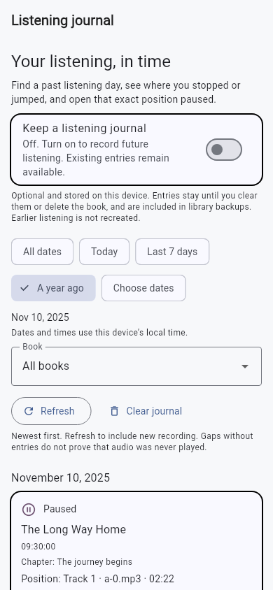
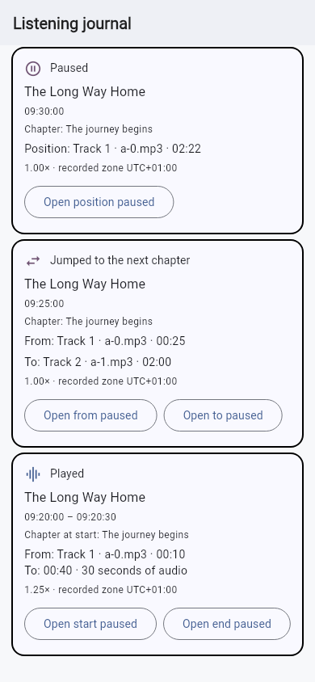
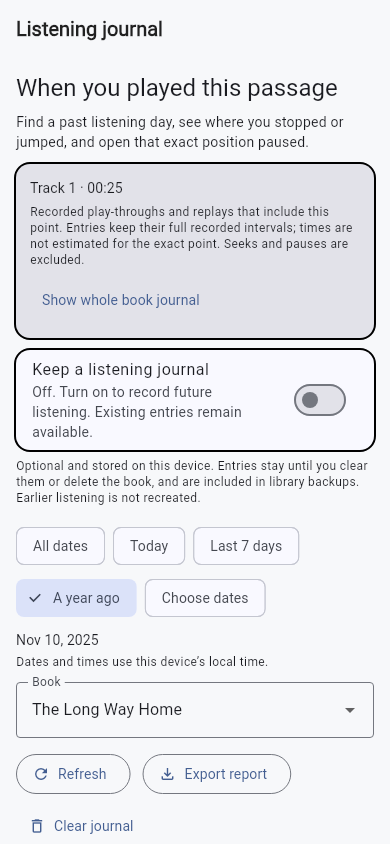
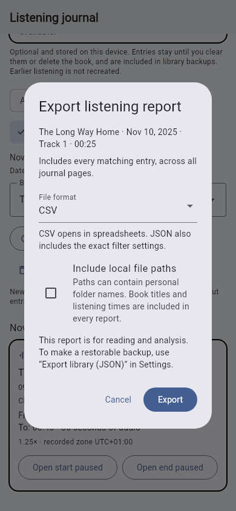

# Listening journal

The optional journal answers **what played, when it played, and where the player
paused or jumped**. It retains dated physical positions so a past listening day
can lead back to the original audio.

## Turn recording on

Open **History → Journal → Keep a listening journal**, or use the same switch in
Settings. Recording is **off by default**. Enabling it starts from a fresh
observed position, including when audio is already playing. Disabling it stops
future capture and leaves saved entries available.

The journal has **no automatic expiry and no recent-entry count cap**. It remains
until explicitly cleared or the corresponding book is deleted. Keep library
metadata backups if you need to restore after device loss or reinstalling;
metadata backups do not contain the audio files.

## Find a day or book

- **A year ago** opens the same calendar date in the previous year; February 29
  falls back to February 28 when needed.
- **Today**, **Last 7 days**, **Choose dates** and **All dates** control the range.
- The book filter narrows the view while retaining the selected dates.
- **Load older entries** uses stable cursor pagination. New recording does not
  move the entries you are inspecting; choose **Refresh** to see new entries.

Displayed dates and date filters use the device's current local time. Records
store UTC timestamps plus the local UTC offset observed during recording. The
captured offset is also shown, so changing time zones does not silently replace
the original clock context. A passage crossing a selected date boundary is
shown whole with its original start and end, rather than inventing a clipped
audio position.

## Find when a passage played

In **Listening map**, select a point or a listed gap and choose **Playback
dates**. The journal opens with that exact book, physical track and position
or range selected. Looking up dates does not seek, pause, change the active
book, or enable journal recording.

Point lookups include recorded playback covering that point, with an exclusive
end boundary. Range lookups include recorded playback overlapping any part of
the range. Ordinary plays and **Return Trail replay** entries are both shown;
pause positions and seek endpoints do not count as playback. Each result keeps
its complete original interval and timestamps. The app does not interpolate a
wall-clock timestamp for the selected millisecond.

The date filters work within a passage lookup. **Show whole book journal**
removes the passage selection while keeping the book and dates; selecting a
different book also removes the old passage selection. Empty results explain
that the map may contain coverage from before dated recording was enabled.
Historical records remain searchable when an audio file is unavailable, while
opening an old position still requires the separate availability checks below.

## Read the evidence

**Played** rows show physical start/end positions, observed start/end times and
speed. Continuous playback extends one durable entry across two-second
checkpoints. Replaying a passage creates another dated entry; it is not merged
into the first listening. **Return Trail replay** rows identify review playback,
while the ordinary Listening map and session totals remain protected.

**Paused**, **Stopped**, completion and interruption events preserve physical
positions. **Jumped** rows preserve both source and destination, with specific
labels for chapter/track navigation, skip controls, smart rewind, bookmarks,
map jumps and Return Trail navigation. These are observed actions, not guesses
that every gap was a deliberately skipped chapter.

Older history remains under **History → Sessions**. Its endpoints cannot
establish exact played intervals, so the new journal is not backfilled. Missing
entries can also mean recording was off, history was cleared, another device
was used or playback callbacks were unavailable. The journal measures recorded
playback, not attention or comprehension. Abrupt process/device loss can lose
the final uncheckpointed observations; known pauses and background transitions
flush pending data.

## Reopen an old position safely

A passage offers **Open start paused** and **Open end paused**. A jump offers
**Open from paused** and **Open to paused**. Point events offer **Open position
paused**. The app validates the book, physical track and bounds before changing
playback. Unknown-duration positions require recorded evidence.

Opening a different position saves the current place as a manual **Before
journal jump** bookmark, then opens the historical position paused. This works
across books and exits an active Return Trail safely. Press Play when ready;
the deliberate historical target is not moved by smart rewind.

## Backups, privacy and deletion

Journal data stays local and is included in explicit library metadata exports.
It is not added to Plex/folder progress sync, and no audio is uploaded. Exports
read the related library tables in one transaction. Restoring merges stable
entry IDs, including newer checkpoints, without double-counting the same
record. Managed file adoption remaps journal paths when applicable.

**Export report** creates a CSV spreadsheet or a JSON report containing every
entry matching the current book, dates and passage selection, including older
pages that have not been loaded. The options dialog captures the filter scope;
after confirmation the player flushes pending observations and reads one
consistent complete snapshot. File encoding, writing and sharing run after
that playback command finishes. Desktop users choose an output folder; mobile
users get a saved report and the system share sheet.

Reports preserve stable entry IDs, title snapshots, exact physical positions,
original UTC epoch/ISO timestamps, the recorded UTC offset, speed and event
reason. Both source and destination file paths are **omitted by default**,
including the JSON passage filter. Opaque track references relate plays and
jumps without including raw paths. This is not anonymization: titles and
listening times remain personal information. Including local paths requires a
separate opt-in for each export. CSV text is quoted and protected from being
interpreted as a spreadsheet formula; JSON retains the original strings.

Reports are for reading and analysis, **not restoration**. Use a library
metadata backup for restoration. A canceled options/folder dialog creates no
report; a write failure removes its partial file when possible. Canceling the
mobile share sheet leaves the completed report saved locally. Export does not
change recording preferences or navigation. All matching records are currently
materialized once in memory; output encoding is streamed, with no second full
JSON string. Exceptionally large journals may need a future database-backed
snapshot spool.

**Clear journal** removes dated entries for all books and dates, including those
outside the current view filter. It keeps session history, cumulative coverage,
books and bookmarks. **Clear listening history** pauses playback and removes
the journal, sessions, cumulative map and recent Return Trail ranges. Book
deletion removes that book's entries. Already exported backups remain separate.
The book deletion dialog explicitly includes bookmarks, sessions, the listening
map and journal. Removing downloaded audio while retaining this memory is a
separate future archive action; Delete still means deletion.

## Desktop CLI

```sh
crisperplayer call settings '{"key":"listeningJournalEnabled","value":true}'
crisperplayer journal
crisperplayer journal BOOK_ID
crisperplayer call journal '{"bookId":"BOOK_ID","fromUtcMs":1762732800000,"beforeUtcMs":1762819200000,"limit":50}'
crisperplayer call journal '{"passage":{"bookId":"BOOK_ID","filePath":"/exact/source.mp3","positionMs":90000},"limit":50}'
crisperplayer call journal '{"passage":{"bookId":"BOOK_ID","filePath":"/exact/source.mp3","startMs":90000,"endMs":120000}}'
crisperplayer call journal-open '{"id":"JOURNAL_ENTRY_UUID","point":"end"}'
crisperplayer call clear-journal '{"confirm":true}'
```

`journal` returns `entries` and an optional `nextCursor`. Pass that cursor with
the same book/date/passage filters to fetch the next page. Date bounds are UTC epoch
milliseconds with an inclusive start and exclusive end. `journal-open` accepts
`start`, `end` or, for an explicit jump, `target`. It reports the recovery
bookmark ID when a previous place was saved.

Passage bounds are file-local milliseconds. An explicit `bookId` must agree
with the passage's book, and point and range shapes cannot be mixed. The
existing book/time index is reused; a rare-location lookup may scan that book's
recorded history. There is no schema migration for this query/report feature.

## Screenshots

Actual Flutter renders with fictional test-book metadata:

| Date and book filters | Stops, jumps and played passages |
| --- | --- |
|  |  |

| Exact passage lookup | Filtered report options |
| --- | --- |
|  |  |

See [journal and speed validation](JOURNAL_SPEED_VALIDATION.md).
