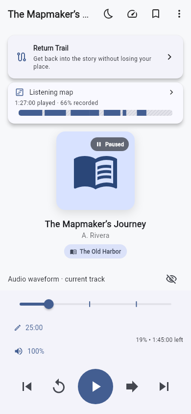
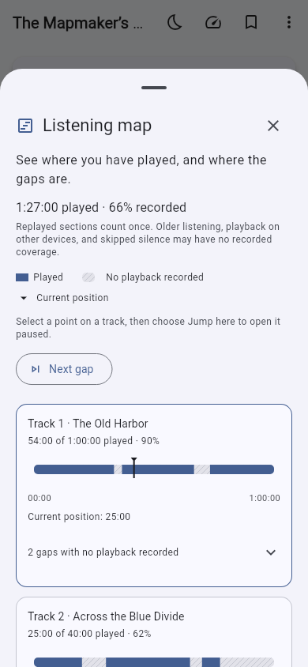
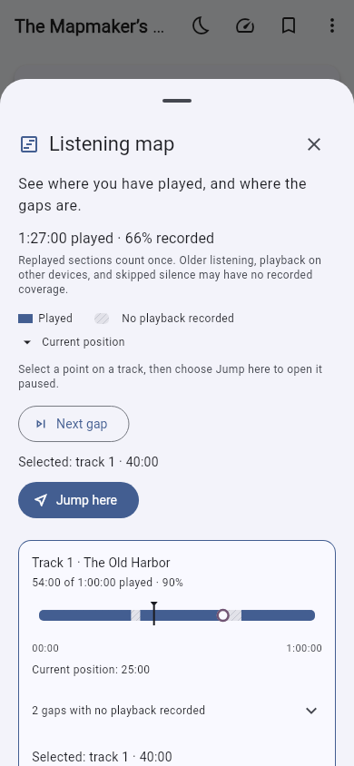

# Listening map

The native player now separates **where you are** from **which audio has recorded
playback**. Open **Listening map** on the player to inspect cumulative coverage.

Solid areas mark played audio. Hatched areas mean **No playback recorded**.
A separate marker shows the current playhead. Replaying an interval counts it
once; seeking forward does not fill the gap. For example, playing 0:00–0:20,
skipping to 1:00 and playing through 1:20 records 40 seconds of unique coverage,
even though the playhead is at 1:20.

## Using the map

- The player card summarizes unique recorded playback, with a whole-book strip
  and percentage when all track durations are known.
- The sheet shows source tracks, played time, visual coverage and exact gap ranges.
  Its track bars distinguish coverage, the playhead and a selected position.
- Select a position to inspect it, then choose **Jump here** to open that point
  paused. Selecting alone does not seek or start playback.
- **Playback dates** opens the dated journal for the selected point or gap
  range. It includes actual recorded plays and Return Trail replays, while
  excluding seeks and pauses. You can inspect dates even if another book has
  become active; jumping from this map still requires the original book.
- **Next gap** selects the next section with no playback recorded. When there
  are no later gaps, it explicitly offers an earlier gap. Press **Jump here**
  to navigate to the selection.
- A deliberate map jump ends an active Return Trail and opens the chosen point
  paused. Its saved-place bookmark remains available.

Coverage updates as normal playback is checkpointed, approximately every two
seconds, and the sheet flushes pending playback samples when opened. The map
does not infer coverage from a bookmark, resume offset, finished flag, chapter
selection, or ordinary session endpoints.

## What an empty area means

“No playback recorded” is deliberately more precise than “never played”. Older
listening, playback on another device, cleared history, or a native silence skip
may lack recorded ranges. The player cannot reconstruct those intervals from a
saved position. The map records audio playback, not attention or comprehension.

When a track's duration is unknown, its map covers only the observed extent and
labels the end as unknown. It does not invent a full duration or completion
percentage. Other tracks with known durations still show their own coverage.
Playback speed changes how long listening takes, but does not change the amount
of unique source audio recorded.

## Durable coverage and privacy

Return Trail retains 200 recent passages for selecting a catch-up. The map uses
a separate cumulative union of physical-file intervals, so earlier played
chapters remain visible after that recent buffer rolls over. Overlapping and
touching intervals merge; gaps are preserved exactly.

Schema six upgrades existing libraries in place. It seeds coverage from the
retained, recorded Return Trail ranges, without reconstructing missing history.
Coverage stays local and is included in explicit library metadata backups.
Restores merge ranges without double-counting or depending on database-local
row IDs. Managed audio adoption updates coverage paths. Deleting a book or
clearing its listening history removes its coverage.

Coverage is not added to optional cloud progress sync; a remote resume position
does not establish which intervening audio played. Audio is never uploaded by
this feature. The separate Pages browser player does not yet have this map.

To retain **when** each passage played, enable the separate optional
[Listening journal](LISTENING_JOURNAL.md). It preserves dated replays and
explicit pauses/jumps; the map remains a cumulative union counted once.
Selecting a recorded area does not guarantee dated entries exist: the journal
may have been off when that coverage was captured. The date lookup explains
this instead of inventing a historical timestamp.

## Desktop CLI

```sh
crisperplayer coverage          # loaded book: unique played intervals and gaps
crisperplayer coverage BOOK_ID  # inspect another book without changing playback
crisperplayer call coverage-seek '{"bookId":"BOOK_ID","filePath":"EXACT_TRACK_PATH","positionMs":20000}'
```

The JSON contains `playedMs`, nullable `durationMs`/`fraction`, and ordered
`tracks`. Each track includes its source path/index/title, played intervals,
gaps, and `timelineExtentMs`. Intervals use half-open file-local millisecond
ranges, `[startMs, endMs)`. Known-duration gaps are the exact complement of the
recorded union. Unknown-duration tracks do not expose invented gap endpoints.
Map jumps validate the current book and track before changing playback; they
stay within the known duration or the observed extent of an unknown track.

## Screenshots and validation

These are actual native Flutter renders at 390 × 844, using fictional test-book
metadata. The map, playhead and selection remain separate.

| Player overview | Played sections and gaps | Selecting a gap |
| --- | --- | --- |
|  |  |  |

See [Listening map validation](LISTENING_MAP_VALIDATION.md) for the checks and
remaining device acceptance work.
