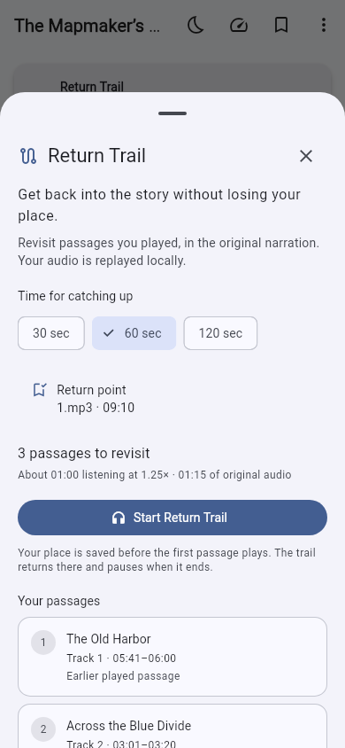
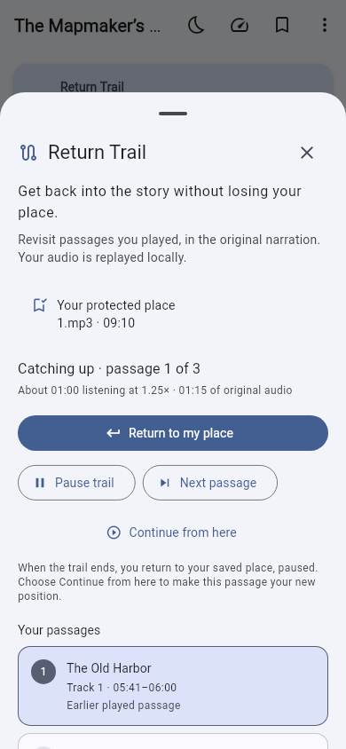
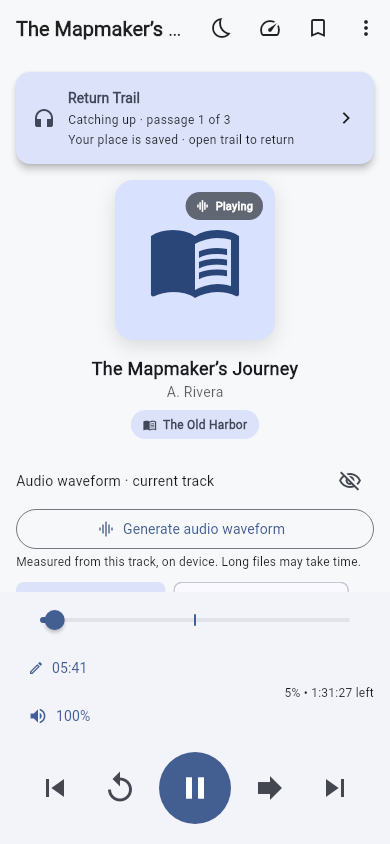

# Return Trail validation

Validated on 10 November 2026 with Flutter 3.44.4 and Dart 3.12.2.
This feature is on `feature/return-trail`; it has not been released to devices.

## Completed checks

| Check | Result |
| --- | --- |
| `flutter analyze --no-pub` | No issues found |
| Focused Return Trail, recorder, CLI, UI, import and migration suites | 55 tests passed |
| Existing playback, sleep timer and desktop control suites | Passed |
| Existing player layout and accessibility suites | 10 tests passed |
| `dart build cli -o build/cli` | Bundle compiled; executable help lists all trail commands |
| `flutter build web --no-wasm-dry-run --no-pub` | Built successfully |
| `git diff --check` | Clean |
| Native Flutter visual inspection | Preview, active trail and player rendered at 390 × 844 with Roboto/MaterialIcons; no clipping or transport obstruction |

The final focused command was:

```sh
flutter test --no-pub \
  test/return_trail_service_test.dart \
  test/return_trail_playback_test.dart \
  test/return_trail_cli_test.dart \
  test/return_trail_ui_test.dart \
  test/return_trail_import_test.dart \
  test/played_range_recorder_test.dart \
  test/database_migration_test.dart
```

Coverage includes source gaps, bounded storage, overlap removal, speed-aware
budgets, unknown timing, stale actions, explicit adoption, disposal, background
checkpoints, sleep timers, queue preservation, decoder failure/retry, pause
during a pending seek, and stale completion events emitted during transitions.
It also covers v1–v4 database upgrades, backup collisions/deduplication, history
clearing, managed audio-file remapping and accessible small-phone controls.

## Full-run and environment limits

The local full Flutter test run completed with **242 passed, 2 skipped and 11
failed**. Every failure was in the unchanged browser-upload suite's setup:
`NetworkInterface.list` raised `SocketException: Failed listing interfaces
(OS Error: Bad value for ai_flags)` before the upload assertions. The new feature
and other completed suites did not fail in that run. The final focused command
above additionally checks the last transition-race regression and UI fixes.

The existing Playwright browser suite could not launch Chromium in this
execution sandbox because Unix socket creation was denied, before any page
interaction. The browser player source is unchanged. GitHub CI is configured
on the draft pull request; consult its current checks rather than interpreting
these local environment failures as a green full-suite result.

No Android/iOS/macOS/Windows/Linux native-device release build or real decoder
listening acceptance was performed here. Before release, verify excerpt
transitions with compressed audio, background/lock-screen playback, interruptions
and sleep timers on each supported backend. Dart-side excerpt boundaries have
native scheduling precision; this is not a sample-accurate clipping feature.

## Screenshots

These are actual Flutter renders with fictional test-book metadata, not product
mockups or images of a user's library.

| Preview | Active trail | Player |
| --- | --- | --- |
|  |  |  |
