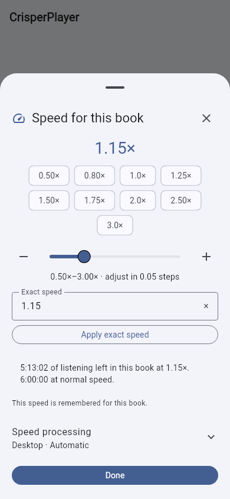
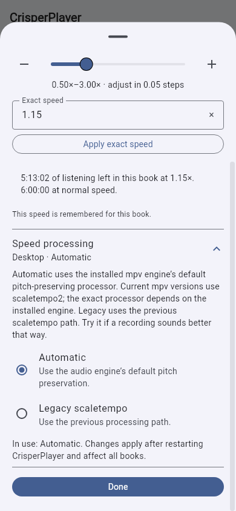
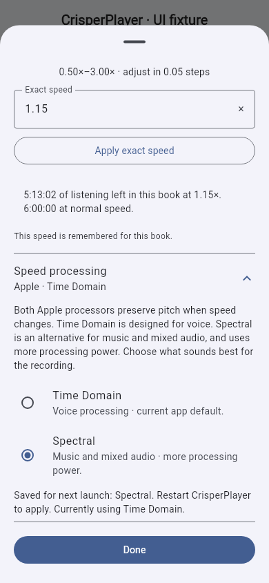

# Playback speed and pitch preservation

The speed sheet accepts exact rates from **0.50× to 3.00×** (up to two decimal
places), offers **0.05×** adjustment buttons and slider steps, and previews the
remaining listening time. The coordinator still owns playback and persists the
selected rate per book. The sheet follows changes made elsewhere, reports
failed changes, and stops controlling a book when another one becomes active.

## What the installed app uses

This assessment is based on the dependency versions in `pubspec.lock`:
`just_audio 0.10.6+crisper.2` (a maintained MIT-licensed adapter to 0.10.6,
with separately licensed native processors),
`just_audio_media_kit 2.1.0`, and `media_kit 1.2.6`.

| Platform | Current speed processing | Choice available in this app |
| --- | --- | --- |
| Android, Sonic | Media3 1.4.1's Sonic processor on the normal decoded PCM path, with audio offload disabled. | Default; selectable. Keeps the existing speech and skip-silence behavior. |
| Android, Bungee Basic | A native, MPL-2.0 phase-vocoder processor with the pinned Eigen/PFFFT source closure. | Experimental opt-in; compare on narration mixed with music or ambience. |
| Android, Signalsmith Stretch | A native MIT processor, using the MIT Signalsmith Linear FFT implementation. | Experimental opt-in; recommended comparison range is 0.75×–1.5×. |
| iOS and macOS, Time Domain | AVFoundation `AVAudioTimePitchAlgorithmTimeDomain`, the upstream voice-oriented default. | Default; selectable. |
| iOS and macOS, Spectral | AVFoundation `AVAudioTimePitchAlgorithmSpectral`, Apple's music-oriented alternative with higher computational cost. | Optional; selectable. |
| Windows and Linux, Automatic | mpv's default pitch-preserving speed path, through media_kit. Current mpv documentation specifies `scaletempo2`; the exact implementation depends on the bundled or installed mpv version. | Default for new launches; selectable. |
| Windows and Linux, Legacy scaletempo | media_kit's independent pitch-control path, with pitch left at 1.0. It installs `scaletempo:scale=...` and turns off mpv's separate automatic pitch-correction filter. | Compatibility alternative; selectable. |

The separate Pages browser player uses browser media playback; this document
describes the native Flutter app.

## Android choice

Open **Speed → Speed processing** and choose **Sonic**, **Bungee Basic**, or
**Signalsmith Stretch**. Sonic remains the default. The preference applies to
all books after restarting CrisperPlayer; the panel distinguishes the processor
active now from a saved choice that is pending restart.

The two native alternatives support mono/stereo PCM at 8–192 kHz and the app's
full 0.50×–3.00× rate range. Support for a rate does not establish that it sounds
better at that rate. Signalsmith's upstream recommendation is approximately
0.75×–1.5×; Sonic remains the speech baseline, particularly at high rates.
At 1.00× the native adapters pass PCM through unchanged.

**Skip silence is available with Sonic.** The first version of the native
alternatives does not combine silence removal with time stretching. Global and
per-book preferences are retained, but the controls show that the feature is
unavailable for the current processor. Choosing a pending mode does not change
the capability of the running player.

The native modes replace Media3's speed-processing chain; they do not append a
second stretcher after Sonic. They force decoding to PCM and disable encoded
passthrough, offload and AudioTrack speed adjustment so processing cannot be
bypassed or applied twice. Media3 drains the old processing segment before a
rate transition. Seek/reset discards buffered audio, end-of-stream drains the
tail, and the clock maps delivered output back to original source time. These
properties matter to resume, played ranges, Return Trail and the journal.

The unchanged Sonic path does not load the JNI library. Initialization errors
in an explicitly selected native processor are reported rather than silently
claiming that a different engine is running. Native source pins, original
licenses, offline build/test tools and the WAV comparison renderer are in
[the native processor package](../packages/just_audio/native/crisper_dsp/README.md).
These options are experimental pending target-device listening and battery
measurements. See [Android validation](ANDROID_AUDIO_PROCESSORS.md).

## Desktop choice

Open **Speed → Speed processing**. Choose **Automatic** or **Legacy scaletempo**.
The preference applies to all books **after restarting CrisperPlayer**. The
sheet identifies the mode used by the current process and a pending selection
separately. It never claims to switch the running decoder when only a preference
has changed.

Automatic is configured before player creation using the public
`JustAudioMediaKit.pitch = false` option. Despite that option's name, it disables
*independent pitch shifting*, **not pitch preservation**. With that option off,
media_kit changes mpv's playback `speed` and leaves mpv's default
`audio-pitch-correction` enabled. With it on, media_kit uses its legacy
`scaletempo` route. CrisperPlayer does not expose independent pitch shifting.

Before this change, the adapter's `pitch = true` default implicitly selected the
legacy route on Windows and Linux. The app now makes this behavior explicit and
offers the normal engine-default path, while retaining the previous path for
recordings where the listener prefers it.

## Apple choice

On iOS and macOS, open **Speed → Speed processing** and choose **Time Domain**
or **Spectral**. Time Domain remains the default. Apple documents it as suitable
for voice and less computationally intensive than Spectral. Spectral is intended
for music and is useful to compare on music-backed or mixed recordings; no
CrisperPlayer listening benchmark establishes that it is better for every voice.

The choice applies to all books **after restarting CrisperPlayer**. The UI shows
the currently applied processor and the saved selection separately. Startup
constructs an immutable `DarwinLoadControl.audioTimePitchAlgorithm` configuration
for the shared player. The patched native source sets the public
`AVPlayerItem.audioTimePitchAlgorithm` on each source and loop copy; it does not
swap the active audio processor during playback. The choice is also transported
again if just_audio recreates its native player.

The complete upstream diff, original source hashes, licenses and
update procedure are documented in
[the vendored package provenance](../packages/just_audio/UPSTREAM.md).
The patch uses public AVFoundation APIs and adds no GPL or AGPL library.
The broader app/distribution license review is tracked separately in
[LICENSE_POLICY.md](LICENSE_POLICY.md).

## Other algorithms and tradeoffs

- **Sonic** remains the Android default. The native C implementation is also
  included as the host comparison baseline; the default app path continues
  to use Media3's implementation rather than replacing it with the C copy.
- **scaletempo2** uses Chromium's waveform similarity overlap-and-add (WSOLA)
  approach. Current mpv selects it automatically for pitch-corrected speed
  changes. The mpv manual describes improved quality relative to older
  scaletempo and Rubber Band's R2 engine; this is an upstream characterization,
  not a CrisperPlayer listening benchmark.
- **Signalsmith Stretch** and its current **Signalsmith Linear** dependency use
  MIT licenses. The Android alternative now has a real native PCM integration.
  The author says time stretching sounds best for modest changes around
  0.75×–1.5×, so it should not be assumed to improve 2×–3× audiobook speech.
  Its adapter handles input/output latency, seek priming and flush behavior to
  preserve track boundaries and original source timestamps.
- **Bungee** provides a C++ streaming/granular stretcher under MPL 2.0. MPL is
  file-level copyleft, with source/notice obligations, rather than an
  unrestricted permissive license. The vendored Basic build includes only the
  selected Eigen/PFFFT source closure, original notices and file hashes. It uses
  `EIGEN_MPL2_ONLY`; no unsupported Eigen modules or proprietary Bungee Pro code
  are included.
- **SoundTouch** uses LGPL 2.1 and supplies a native streaming processing API.
  It is another candidate for a measured comparison, not an established upgrade
  over the app's existing Sonic speech processing. LGPL obligations for source,
  replacement/relinking and distribution terms still need to be satisfied;
  "LGPL" alone is not a blanket App Store clearance. Prefer the existing
  AVFoundation processor choices on Apple platforms while this is unresolved.
- **Rubber Band** is available under GPL-2.0-or-later or a separate commercial
  license. Its normal open-source license fails this project's no-GPL/AGPL
  dependency policy, so it is excluded from the open-source processor options.

The Bungee and Signalsmith native integrations are currently Android-only.
iOS/macOS retain the public AVFoundation choices; Windows/Linux retain the
documented mpv choices. SoundTouch remains an unintegrated candidate. Sharing
the native core across platforms does not itself connect it to another
platform's decoder or audio output.

No algorithm is claimed to sound best for every narrator, recording, speed,
device or listener. A processor listening comparison should use the same
spoken passages, matched output level, several voices/languages and both
speech-only and music-backed material, while measuring CPU/battery use and
seeking/interruption behavior. Interface and configuration tests do not establish
audible superiority.

## Primary references

- [just_audio_media_kit configuration and public pitch option](https://pub.dev/packages/just_audio_media_kit)
- [media_kit source: native setRate/setPitch paths](https://github.com/media-kit/media-kit/blob/main/media_kit/lib/src/player/native/player/real.dart)
- [just_audio source: Apple UriAudioSource](https://github.com/ryanheise/just_audio/blob/minor/just_audio/darwin/just_audio/Sources/just_audio/UriAudioSource.m)
- [Android: DefaultAudioSink.Builder and speed processing](https://developer.android.com/reference/androidx/media3/exoplayer/audio/DefaultAudioSink.Builder)
- [Android: SonicAudioProcessor](https://developer.android.com/reference/androidx/media3/common/audio/SonicAudioProcessor)
- [mpv manual: audio-pitch-correction and audio filters](https://mpv.io/manual/stable/)
- [Apple: Time Domain](https://developer.apple.com/documentation/avfoundation/avaudiotimepitchalgorithm/timedomain)
- [Apple: Spectral](https://developer.apple.com/documentation/avfoundation/avaudiotimepitchalgorithm/spectral)
- [Signalsmith Stretch: implementation, latency and license](https://github.com/Signalsmith-Audio/signalsmith-stretch)
- [Signalsmith Linear: MIT license](https://github.com/Signalsmith-Audio/linear/blob/main/LICENSE.txt)
- [Bungee: streaming API and MPL license](https://github.com/bungee-audio-stretch/bungee)
- [Mozilla: MPL 2.0 FAQ](https://www.mozilla.org/en-US/MPL/2.0/FAQ/)
- [SoundTouch: LGPL 2.1 license](https://surina.net/soundtouch/license.html)
- [Rubber Band licensing](https://breakfastquay.com/rubberband/license.html)

References reviewed 10 November 2026. Local package sources were inspected in
addition to documentation; online defaults may change with future dependency
updates.

## Screenshots and validation

Actual Flutter renders at 390 × 844 with fictional book metadata:

| Precise rates and time estimate | Supported desktop processing choice |
| --- | --- |
|  |  |

See [journal and speed validation](JOURNAL_SPEED_VALIDATION.md).

Apple processing selection, rendered from the real Flutter widget with fictional
book metadata. Time Domain remains active while Spectral is saved for restart:

